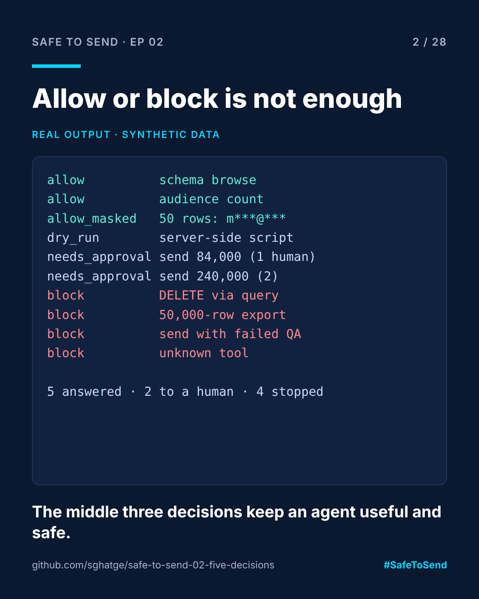

<div align="center">


**SAFE TO SEND · GOVERNED AI ENGINEERING SERIES · SAFE TO SEND 02 FIVE DECISIONS**

[GitHub Profile](https://github.com/sghatge) · [Portfolio](https://sghatge.github.io/adobe-campaign-v8-governance/)

</div>

---

# safe-to-send-02 · Five Decisions



**Safe to Send · Episode 02** — a 28-day learn-in-public series on governing AI in CRM operations.

> Allow or block is not enough. Real CRM work needs five decisions.

## The real-world scenario

A team gives an AI agent "read-only" access to Adobe Campaign. It still pulls 50 recipient rows, with names and email addresses, into its context window. Read-only was never the same as safe.

## The five decisions

| Decision | What happens | Example |
|---|---|---|
| `allow` | Runs | Schema browse, audience count, aggregate query |
| `allow_masked` | Runs, personal data masked before the agent sees it | 50 sample recipient rows |
| `dry_run` | Explained, never executed | Server-side JavaScript |
| `needs_approval` | Waits for 1 human, or 2 above 100,000 recipients | Delivery send |
| `block` | Stopped, with a safe alternative | SQL writes, data export, failed QA, unknown tools |

## Run it

```bash
python five_decisions.py examples/session.json
```

## Real example output (11-call synthetic session)

```
  3  query_run       allow_masked    row-level personal data
     masked preview: [{'email': 'm***@***', 'first_name': 'M***', 'country': 'SI'}, ...]
  5  query_run       block           query looks like a write  -> instead: describe the change; a human runs it
  6  js_execute      dry_run         server-side script is explained, never executed
  9  delivery_send   needs_approval  2 human approver(s) required
 10  delivery_send   block           pre-send QA failed  -> instead: fix the failing checks first
 11  privacy_purge_pause block       tool not named in policy (fail closed)

allow: 3, allow_masked: 1, block: 4, dry_run: 1, needs_approval: 2
```

## Why the middle three matter

`allow_masked`, `dry_run` and `needs_approval` let an agent stay useful on real work while the risky part stays with a human. Every block also names a safe alternative, so the agent is redirected, not just stopped.

## Where this fits

The full implementation, with a YAML policy, hash-chained audit and an MCP server, is [ACC Agent Gate](https://github.com/sghatge/acc-agent-gate).

Independent project, not affiliated with Adobe. Synthetic data only. MIT · [Sangram Ghatge](https://www.linkedin.com/in/sangram-g-2369705b) · #SafeToSend
